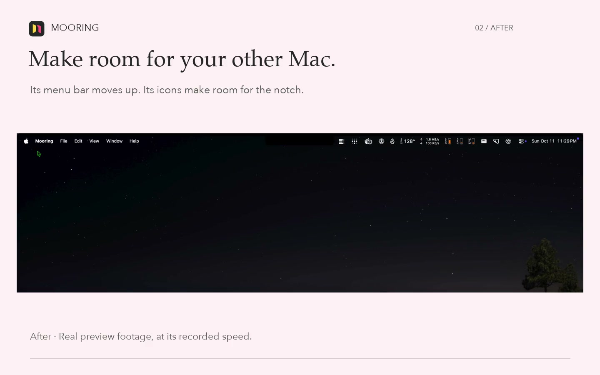

<p></p>

# Mooring

**Your other desktop. On your Mac.**

Native remote desktop for Macs and Linux. Apple silicon, macOS 14+, no Mooring account. MIT source.

**[Download](https://github.com/kcirtapfromspace/mooring/releases/latest)** · **[Watch the demo](https://kcirtapfromspace.github.io/mooring/#demo)** · **[Setup](docs/TESTING.md)**

[](https://kcirtapfromspace.github.io/mooring/#demo)

## Features

| Feature | Availability |
| --- | --- |
| Paired Mac control, clipboard, sound, and gestures | Signed preview 45 |
| Matched display and camera-notch support | Signed preview 45 |
| Omarchy/Hyprland through SSH and wayvnc | Signed preview 45; experimental |
| Ubuntu/X11 and Jetson through x11vnc | Source build 51 |
| Rust/Iroh Internet Links: direct QUIC or HTTPS relay | Source build 51; experimental |
| Owned SSH session for concurrent Linux channels | Source build 51; advanced workflow |

The signed download remains preview 45. The next Mac release awaits signing and notarization.

<details>
<summary>Internet Links</summary>

Approve an Internet ID and exchange an expiring locator. Noise or SSH still authenticates the connection.
Mooring does not operate a hosted relay.

Forced-relay SSH passed on Omarchy and Jetson. A Jetson desktop was demonstrated.
Direct-only testing timed out; real Mac Internet desktop acceptance remains open.

[Setup and commands](docs/INTERNET-CONNECTIVITY.md) · [Validation](docs/INTERNET-VALIDATION.md)

</details>

<details>
<summary>Architecture and limits</summary>

Swift supplies AppKit and Apple media adapters. Rust owns domain rules, protocols, storage, and process lifetimes.
Noise, Iroh/QUIC, OpenSSH, Keychain, and Sparkle retain separate responsibilities.

One viewed Mac and one viewer per host. Linux sound, clipboard, and gestures are not included.
Automatic stream quality selection remains simulated.

[Architecture](docs/ARCHITECTURE.md) · [Telemetry](docs/TELEMETRY.md) · [Dependency notices](docs/THIRD-PARTY-NOTICES.txt)

</details>

## Build

Run on the local Apple silicon Mac with the [pinned toolchains](build/native-targets.json).

```sh
./scripts/ci-local.sh
./scripts/build-app.sh
open dist/Mooring.app
```

Source builds include the experimental Internet menu and helper. Set `MOORING_EXPERIMENTAL_INTERNET=0` to omit them.

```sh
./scripts/build-internet-helper-linux.sh
```

The Linux helper targets arm64 and glibc 2.27+. All builds run locally. GitHub Actions remains disabled.
Development builds use ad hoc signing.

[Release delivery](docs/NOTARIZATION.md) · [Documentation style](docs/DOCUMENTATION.md) · [Recording brief](docs/DEMO-RECORDING.md)
