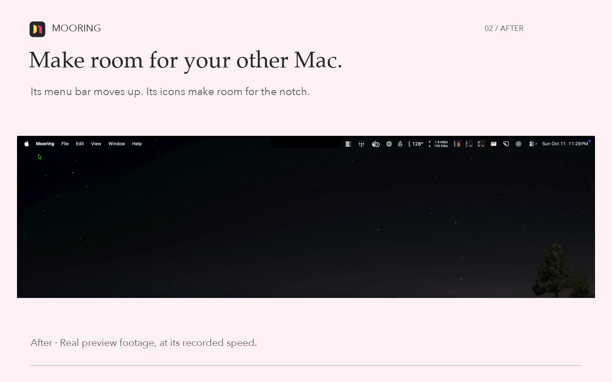

<p></p>

# Mooring

**Your Macs, within reach.** Use the Mac at your desk from the Mac in your bag. Mooring is a native remote desktop app for Apple silicon Macs, with shared clipboard, sound, and familiar trackpad gestures.

**[Download the free preview](https://github.com/kcirtapfromspace/mooring/releases/latest)** · **[Watch the 30-second demo](https://kcirtapfromspace.github.io/mooring/#demo)** · [Setup and testing guide](docs/TESTING.md)

Apple silicon · macOS 14 or later · Developer ID signed and notarized · Free preview · No Mooring account · MIT-licensed source

[](https://kcirtapfromspace.github.io/mooring/#demo)

Pair your Macs with a six-character PIN, start sharing on the Mac you want to reach, and connect from the other. Use the same network, or your own VPN when away. In full screen, the remote Mac's menu bar can fit around your MacBook's camera notch. Each paired viewing Mac has its own key, and you can remove its access individually.

**Early preview:** one Mac viewed at a time, one viewer per sharing Mac, and no hosted internet relay. Reliability testing is ongoing; real two-Mac PIN pairing remains an acceptance check in the current release notes. See the [latest release notes](https://github.com/kcirtapfromspace/mooring/releases/latest) for current limits, including experimental Linux desktop support through SSH.

**Linux:** preview 45 includes Omarchy/Hyprland through wayvnc over SSH. X11 compatibility is in local development build 50, not that public preview. Read the [Linux overview](https://kcirtapfromspace.github.io/mooring/#linux). Product recordings must show Mooring’s connection workflow and a graphical Linux desktop inside its Mac window; the [recording brief](docs/DEMO-RECORDING.md) describes the required scenes.

Source, downloads, and the signed update feed live together in the public [Mooring repository](https://github.com/kcirtapfromspace/mooring). The product goal is reliable, responsive remote control with sensible automatic quality; the streaming quality policy is still simulated.

**Current milestone:** Macs connect through Mooring's own encrypted session (below), and Linux desktops open in Mooring's own viewer through SSH. Mooring no longer uses Apple Screen Sharing; addresses saved for it stay listed, marked **Needs pairing**, until you pair that Mac or remove them. There is no claim of performance parity or measured video bandwidth.

**Experimental:** a direct native session. **Share This Mac** captures the main display with ScreenCaptureKit and hardware H.264; **Pair a Mac** pairs with a 6-character PIN that the other Mac shows (**Show Pairing PIN…**), choosing it from the Macs nearby or by address, whether or not either Mac is sharing or viewing; a long one-time code still works for pairing over a VPN. A paired Mac then views or controls the other over an encrypted, authenticated connection: at home, or away through a VPN such as Tailscale, trying every address it learned when pairing. One Mac can pair with many sharing Macs and switch between them. Each viewing Mac has its own key, and the sharing Mac can remove any one of them. Sharing can start automatically and continues without its window. A dropped viewer reconnects on its own, including after its lid was closed, and a sharing Mac whose display has turned off wakes for it. The clipboard is shared both ways while connected. Trackpad pinch, rotate and smart zoom reach the remote Mac, and its sound plays on the viewing Mac. With Accessibility on the viewing Mac, ⌘-Tab and other system shortcuts go to the remote Mac; until it's allowed, the viewer says so when control starts. The pointer reaches every edge of the remote screen, so a Dock or menu bar that hides automatically appears there. In full screen on a Mac with a camera notch, the remote Mac's menu bar moves up beside the notch and its menus leave room for it (**Settings → Viewing → Use the space beside the camera**; needs this preview on both Macs). Early two-Mac testing is in progress. Live telemetry and tuning (`mooring telemetry`, `mooring tune`) are described in [TELEMETRY.md](docs/TELEMETRY.md). Mooring updates itself in place from [Mooring releases](https://github.com/kcirtapfromspace/mooring) when no session is connected. See the [release notes](docs/release-notes-v0.3.0-preview.37.md) for limits.

## Run

Requires macOS 14 or newer, Xcode Command Line Tools, and Rust 1.89 or newer.

```sh
./scripts/build-app.sh
open dist/Mooring.app
```

Mooring appears in the Dock, Cmd+Tab, and the menu bar with its Threshold icon. Closing its windows keeps it running; open Connections from the Dock or menu bar. Choose **Pair a Mac** to pair with another Mac's PIN or pairing code, **Show Pairing PIN…** to let another Mac pair with this one, or **Share this Mac** to make this Mac available to the Macs paired with it. Settings groups preferences into **Sharing**, **Viewing**, and **General**. The visual identity and icon source are described in [BRANDING.md](docs/BRANDING.md).

For recording a demo, turn on **Settings → General → Hide computer information for demos**. Mooring substitutes anonymous Mac labels and fictional endpoints in its windows, menus and tooltips: `mac-1.no-route-home.invalid`, “NXDOMAIN sweet NXDOMAIN,” and reserved documentation addresses `192.0.2.1` and `2001:db8::dead:beef`. These examples are presentation only; connections still use their real saved endpoints. The choice persists and updates open Mooring windows immediately. It does not hide content inside a remote desktop. With it off, Connections and Settings → Viewing show every saved address for each paired Mac, with readable scope labels and the last connected address first. Settings → General lists this Mac's Bonjour hostname and assigned IPv4 and IPv6 addresses by interface, including VPN, link-local and inactive interfaces. Saved remote addresses are the ones Mooring learned when pairing; the list is not a live network discovery scan.

Either Mac can remove a native pairing without the other's approval. Removal on the sharing Mac rejects that viewer's key; removing a connected Mac on the viewing side sends an authenticated revocation notice and erases its local credential. Offline removal takes effect locally immediately and requires a fresh code to connect again; it cannot update an unreachable Mac's Allowed Macs list. New pairings use a separate device key for each sharing Mac, while existing pairings retain their keys until paired again. Removing one never rotates other pairings. If an existing Keychain item refuses deletion with ownership error `-25244`, Mooring erases its credential and key without editing the item's ownership; if erasure also fails, removal reports an error and keeps the saved row for retry.

In a native viewer, **View → Diagnostic Footer** (⌃⌘D) shows or hides the footer, including in full screen. The choice is remembered and is also in **Settings → Viewing**. **View → Stats for Nerds** (⌃⌘I) opens live stream details over the picture, with a **Save Diagnostics** action. These two shortcuts stay on the viewing Mac while remote input is captured. Stats consume measurement and peer-telemetry events as they arrive, without a repeating UI refresh timer; display updates are capped at 10 per second. Local rates cover a rolling second, host stats arrive in one-second samples, and recovery counters cover the session. Stats distinguish received video bitrate from the host's bitrate target and network RTT from screen-to-display latency. Unavailable values show **—**, and host samples expire after three seconds. A still screen can legitimately show zero FPS. These measurements apply to Mac-to-Mac sessions; the Linux viewer's footer shows its own size, update rate, data rate and lock state.

**Full screen on a Mac with a camera notch.** With **Settings → Viewing → Use the space beside the camera** on (the default), the sharing Mac's menu bar moves up beside the notch. The sharing Mac keeps the part behind the notch clear with an invisible menu bar item, so its icons sit on either side. They shuffle for a few seconds while it finds the spot.

If a wide empty space stays between the notch and the sharing Mac's icons, some of those icons have probably never been rearranged. macOS can then give them one shared stored position and keep them together as a block that no app can place an item inside, so the whole block moves left of the notch. To fix it, on the sharing Mac hold ⌘ and drag each icon in that block once, in the order you like; dropping it back in place is enough. Each drag gives the icon its own position, and the next full-screen session fits the gap to the notch.

The sharing Mac's session log shows how close it got (`menu bar gap placed beside the viewer's camera, N points to spare`). `scripts/probe-menu-bar-order.swift` maps where a Mac can place a new menu bar item.

**Linux desktops.** Run a VNC server such as wayvnc on the Linux computer, then choose **Add Linux Desktop** and enter how you reach it with SSH: an `~/.ssh/config` alias or `user@host`. Connecting opens an SSH tunnel with your own keys and agent (Mooring never asks for an SSH password and listens on 127.0.0.1 only), checks read-only whether the desktop is locked, and asks once for that computer's account. The password goes to the VNC server encrypted (RSA-AES) inside SSH, is sent once and is never saved or logged. After two rejected sign-ins within ten minutes Mooring waits before allowing another try. With **Settings → Viewing → Match this screen** on, the desktop shows on a virtual Hyprland screen sized to the picture area in full screen (wayvnc captures it). With **Use the space beside the camera** also on, as in Mac-to-Mac viewing, that includes the row beside the camera housing, so the desktop's top bar sits beside it. While the virtual screen is up, Hyprland's own pointer is hidden and this Mac's pointer is the only one: Hyprland would otherwise draw its pointer into the picture, a frame behind. The computer's own screen, pointer and workspaces come back when you disconnect, and on their own within about 20 seconds if Mooring quits or the connection drops. The viewer opens full screen as in Mac-to-Mac viewing, with this Mac's menu bar and Dock hidden; the Mac-to-Mac viewer's footer (⌃⌘D) stays below the picture, with **Exit Full Screen**, and shows the size, update rate, data rate and lock state. ⌘ is the desktop's Super key. With Mooring allowed in Accessibility on this Mac (**Allow ⌘-Tab…** in the footer), ⌘-Tab, ⌘-Space and other system shortcuts reach the desktop too, as in Mac-to-Mac viewing; ⌃⌘F, ⌃⌘D, ⌃⌘Q and ⌥⌘Esc always stay on this Mac. If the desktop is locked, unlock it in the viewer; Mooring never types a password into a lock screen. Tested with wayvnc 0.10.2 on Hyprland (Omarchy). Mooring never selects Apple Diffie-Hellman sign-in, which crashes that wayvnc version.

Builds and GitHub preview releases target Apple silicon (arm64) only. Download the [native session preview](https://github.com/kcirtapfromspace/mooring/releases/latest). Distribution uses Developer ID signing, Apple notarization, and a stapled ticket checked after extracting the final ZIP. Local development builds remain ad hoc by default. See [testing instructions](docs/TESTING.md) and the [notarization workflow](docs/NOTARIZATION.md).

## CLI

```sh
cargo run -p mooring-cli -- doctor
cargo run -p mooring-cli -- add --name 'Linux' --ssh m1-linux
cargo run -p mooring-cli -- list
cargo run -p mooring-cli -- inspect SAVED_ID
cargo run -p mooring-cli -- desktop-status SAVED_ID
cargo run -p mooring-cli -- vnc-check SAVED_ID
cargo run -p mooring-cli -- connect SAVED_ID
cargo run -p mooring-cli -- simulate
cargo run -p mooring-cli -- telemetry --count 5
cargo run -p mooring-cli -- tune --bitrate-mbps 15
```

`simulate` is synthetic telemetry, not a live performance benchmark. Commands return JSON; failures return a nonzero status with a readable error on stderr. Use `--config-dir PATH` before the command, or set `MOORING_HOME`, for an isolated connection store. New installations use `~/Library/Application Support/Mooring/connections.json`; existing installations continue using their saved-data directory. writes are atomic and serialized across app/CLI processes. Saved files use owner-only permissions.

## Layout

- `crates/mooring-core`: the SSH tunnel lifecycle, the remote desktop lock-state reading, and the simulated streaming quality/mailbox/reconnect foundation.
- `crates/mooring-platform`: host validation, read-only RFB greeting diagnostics, the system-ssh tunnel and the read-only desktop check.
- `crates/mooring-vnc`: Mooring's VNC client for Linux desktops: RSA-AES sign-in, Raw/CopyRect/ZRLE decoding, key mapping and the failed-sign-in budget.
- `crates/mooring-cli`: JSON command interface and saved Linux desktops.
- `crates/mooring-session`: experimental native session (static library): encrypted transport, typed wire formats and validation, per-role policy, host input state, pairing codes and saved peers. See its [README](crates/mooring-session/README.md).
- `app`: native menu, settings, the Mac-to-Mac viewer and host, and the Linux viewer window; Rust handles protocols, validation, policy and saved connections.
- `scripts/probe-codecs.swift`: public VideoToolbox capability probe; no screen capture or transmission.
- `docs/performance.md`: proposed performance targets and measurement method.
- `docs/roadmap.md`: acceptance gates for the real remote-desktop engine.

## Verify

All CI runs on the local development Mac. GitHub Actions is disabled for this repository, and no Actions workflows are included. Run `./scripts/ci-local.sh` for the complete local check.

```sh
cargo fmt --all -- --check
cargo test --workspace
cargo clippy --workspace --all-targets -- -D warnings
./scripts/build-app.sh
swift scripts/probe-codecs.swift
```

Network tests use loopback mock RFB servers. No test enables remote sharing, captures the desktop, stores credentials, or connects to a real remote Mac. `scripts/test-ssh-tunnel-live.py` checks a real Linux host through SSH, separately from CI, and never signs in.

The original source in this project is MIT-licensed. External projects cited in the research retain their own licenses; no iShareScreen implementation code is included.
