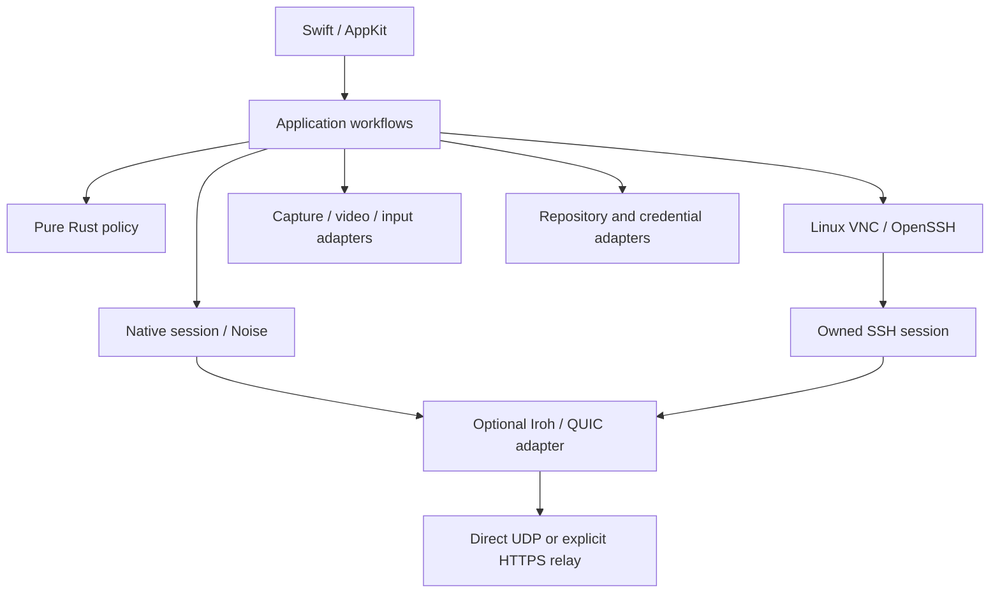

# Mooring architecture

Mooring is one native Mac application with a Rust engine.
Swift supplies windows and Apple API adapters.
Rust owns domain rules, protocols, persistence, and process control.

## System boundary



The Internet transport provides reachability.
Noise or SSH provides application authentication.
Transport approval alone does not authorize desktop access.

## Domain contexts

| Context | Owns | Adapter or application boundary |
| --- | --- | --- |
| Connection catalog | Saved names, endpoint validation, and the repository contract | `mooring-storage::catalog::Store` |
| Linux connection | Connection phases, one sign-in intent, cancellation, and cleanup | `LinuxConnectionWorkflow` |
| Pairing and trust | Approved devices and credential removal order | `NativeTrustWorkflow` |
| Native viewing | Viewer state, input, and bounded reconnection | `NativeSessionCoordinator` and `NativeReconnectWorkflow` |
| Native hosting | Capture state, display policy, and input eligibility | Hosting workflow and Apple adapters |
| Internet reachability | Endpoint approval, locator expiry, transport limits, and cancellation | `mooring-connectivity` |

These contexts use separate models.
A Mac pairing credential is not a Linux catalog record.
A transport endpoint ID is not a Noise device key.
A crate boundary alone does not define a domain context.

## Source tree

```text
app/
  Mooring.swift                         application composition and menus
  LinuxConnectionWorkflow.swift         Linux application workflow
  NativeSessionCoordinator*.swift      native session workflows
  NativeSessionPorts.swift              injectable application effects
  NativeInternetLinks.swift             Internet UI and Keychain adapter
  NativeVirtualDisplay.m                isolated CoreGraphics boundary
crates/
  mooring-core/                         pure models and policy
  mooring-storage/                      catalog file adapter
  mooring-platform/                     SSH processes and desktop probes
  mooring-cli/                          typed JSON commands
  mooring-vnc/                          Linux VNC protocol and decoder
  mooring-session/                      native protocol, stores, and C ABI
  mooring-connectivity/                 Iroh adapter and Internet helper
build/native-targets.json               native source and toolchain manifest
scripts/                               local validation and release commands
site/                                  prebuilt GitHub Pages files
```

## Application composition

`AppDelegate` supplies the Linux workflow's tunnel, viewer, prompt, scheduler, and preferences.
Rust's `LinuxSession` model permits the legal transitions.
Each attempt has a generation ID.
A late callback cannot open a viewer for an obsolete attempt.
A rejected password is not submitted again automatically.

`NativeSessionCoordinator` supplies the native session lifetime.
Its hosting, viewing, pairing, and service implementations are separate files.
`NativeSessionDependencies` supplies repositories, credentials, blocking I/O, a clock, and a scheduler.
Construction does not start background services.
The application calls `start()` after composition.
The application calls `stop()` to release those effects.

`NativeTrustWorkflow` saves credentials before peer metadata.
It removes credentials before metadata when a pairing is forgotten.
A failed credential operation preserves the saved row for recovery.
`NativeReconnectWorkflow` owns retry timing and cancellation.

## Storage and protocol boundaries

`mooring-core` opens no sockets and starts no processes.
The CLI accepts the `ConnectionRepository` contract.
`mooring-storage` supplies the file implementation.
The file adapter preserves existing JSON, directory selection, atomic writes, locks, and permissions.
Existing saved connections require no migration.

`mooring-session` owns native pairing, wire validation, and session policy.
`mooring-vnc` owns VNC sign-in and framebuffer decoding.
`mooring-platform` owns SSH processes and read-only desktop probes.
The C ABI transfers fixed-layout values between Rust and Swift.

Process events decode into typed values.
A malformed known event ends the affected attempt.
Unknown event types are ignored for forward compatibility.
SSH stderr drains into a bounded buffer.
A verbose child process cannot block on a full stderr pipe.

## Internet transport

`mooring-connectivity` depends on the core's transport types and limits.
It does not depend on AppKit or the native session engine.
The session engine composes the adapter below its authenticated byte protocol.
The Linux helper composes the adapter below OpenSSH.

The Mac stores a separate Internet transport seed in Keychain.
Public locators remain in memory.
A locator contains addresses, an endpoint ID, a version, and an expiry.
It contains no pairing secret.
No public endpoint discovery publisher is enabled.
The user supplies the relay URL.

The native adapter forwards opaque bytes through loopback.
The existing Noise handshake remains mandatory.
The viewer reports the selected Iroh path.
Internet sessions do not use the loopback TCP leg as a network RTT or queue measurement.
The host reports a conservative Internet label because its TCP listener cannot identify the selected QUIC path.

The Linux helper's `ssh-session` command owns one foreground SSH connection.
Video, desktop checks, and display cleanup use separate channels on that connection.
Only the owned SSH connection uses the QUIC bridge.
This prevents separate proxy processes from registering the same Iroh identity at one relay.

The helper creates a private directory, SSH configuration, and control socket.
The socket name separates SSH hosts, ports, and user accounts.
The child command receives `MOORING_SSH_CONFIG`.
The original SSH destination and host-key verification remain in use.
Command completion, cancellation, timeout, or SSH failure ends the owned processes and removes the temporary configuration.
No persistent control master is installed.

See [Internet Links](INTERNET-CONNECTIVITY.md) for setup, limits, and recovery.

## Resource limits

| Resource | Bound |
| --- | --- |
| Runtime | One two-worker Tokio runtime per helper or app process |
| Active endpoint identities | 32 per process |
| Concurrent server connections | 4 |
| QUIC streams | One bidirectional stream per connection |
| Locator size | 8 KiB |
| Locator addresses | 16, including at most one relay |
| Locator lifetime | 10 minutes |
| Forwarding buffer | 64 KiB per direction |
| Default connection deadline | 10 seconds |
| Default forwarding idle deadline | 30 seconds |
| Default Internet session limit | One hour |
| SSH session setup deadline | 15 seconds |
| Owned child stop budget | One second before forced termination |
| SSH diagnostic tail | 8 KiB |
| Server acceptance budget | 64 attempts per host lifetime |

The process shares an Iroh endpoint across compatible host and viewer roles.
Conflicting relay or bind settings are rejected.
Stopping a host role preserves outgoing sessions that still use the endpoint.
Cancellation closes the connection and local forwarding sockets.

## Build and validation

`build/native-targets.json` owns the Swift source graph and reviewed Apple toolchain.
Each Swift source has one source group.
Workflow tests compile all application sources except the entry point.
The build rejects missing or unowned sources.

`rust-toolchain.toml` pins Rust 1.99.0, rustfmt, Clippy, and the arm64 target.
The native manifest pins Swift 6.4.2, Xcode 27B52, and the macOS 27.2 SDK.
The deployment floor is macOS 14.
Mac artifacts contain arm64 code only.
Cargo.lock and the Sparkle checksum pin external dependencies.

Run `./scripts/ci-local.sh` for local validation.
Run `./scripts/build-internet-helper-linux.sh` for the Linux arm64 package.
The Linux target uses glibc 2.27 for the older Jetson installation.
All compilation and packaging run on the local Mac.
GitHub Actions remains disabled.

Automated tests use temporary stores, synthetic media, and loopback servers.
Live device checks remain separate evidence.
The [validation record](INTERNET-VALIDATION.md) distinguishes tests, demonstrations, failures, and outstanding checks.
